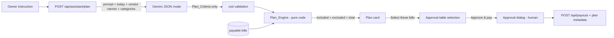

# Design Document

## Overview

Two additions on top of the payment workflow:

1. **Approval table** — `components/BillGrid.tsx` replaces the card list with AG Grid Community 36 (`ag-grid-react`, `AllCommunityModule`, `themeQuartz`). Selection lives in a parent client component (`ApprovalWorkspace`) so both the grid and the assistant can change it.
2. **Payment Assistant** — an agent loop with a strict division of labour:



The AI never sees or returns bill ids, emails or amounts to pay. It returns criteria; code chooses bills and enforces guardrails. Payment always goes through the human approval dialog.

## Plan_Criteria (zod)

```typescript
const planCriteriaSchema = z.object({
  intent: z.enum(['plan', 'clarify']),
  clarification_question: z.string().max(300).nullish(),
  vendor_names: z.array(z.string().min(1).max(100)).max(10).default([]),
  categories: z.array(z.enum(['fuel', 'repair', 'parts', 'driver_trip', 'other'])).max(5).default([]),
  date_from: isoDate.nullish(),
  date_to: isoDate.nullish(),
  max_amount_per_bill: z.string().nullish(),   // "500.00" -> parseAmountText
  max_total: z.string().nullish(),
  include_flagged: z.boolean().default(false),
  include_failed: z.boolean().default(false),
  summary: z.string().min(1).max(500),
}).strip();                                      // unknown keys (e.g. bill_ids) are dropped
```

Prompt (in `lib/assistant/prompt.ts`) gives: today's date (UTC, YYYY-MM-DD), the week definition (Monday–Sunday), the list of vendor display names, the five categories, and rules: "Never invent bill ids or amounts. Only include flagged bills if the owner explicitly says flagged/all/including flagged. If the request is not about paying bills, or is ambiguous, set intent=clarify."

## Plan_Engine (`lib/assistant/planEngine.ts`, pure)

```typescript
type PlanBill = Pick<BillWithDetails, 'id' | 'status' | 'vendor_name' | 'invoice_number' | 'bill_date' |
  'amount_minor_units' | 'category' | 'payee_email' | 'flags'>;

function buildPlan(bills: PlanBill[], criteria: PlanCriteria, opts: { planCapCents: number }): PaymentPlan
```

Steps:
1. Candidates = bills with payable status, an amount, a date and a payee email.
2. Filter by vendor (normalized-name equality or containment via `normalizeVendorName`), category, date range, per-bill max. Bills failing these are silently dropped.
3. Split near-misses: flagged (unless `include_flagged`) and `payout_failed` (unless `include_failed`) → excluded with reason.
4. Sort remaining by `bill_date` asc, then amount asc, then id.
5. Greedy add while running total + amount ≤ `limit = min(max_total ?? ∞, planCapCents)`; others excluded "Would exceed the plan limit of $X".
6. Reason per included bill: `[Category] · [Mon D] · passed all checks` or `· flagged: Overcharge (you asked to include flagged bills)` or `· retrying failed payment`.
7. Return `{ criteria, included, excluded, totalCents, payeeCount, limitCents }`.

Plan_Cap = 500000 cents ($5,000.00), exported constant.

## Agent orchestration (`lib/assistant/planPayment.ts`)

`planPayment(instruction, { listPayableBills, listVendorNames, generateCriteria, today })`:
- validate instruction length (3–300) → `AssistantInputError`;
- `generateCriteria` (Gemini, 20 s timeout, no retry — the Owner can resubmit) → JSON → zod; failure → `AssistantUnavailableError` with the friendly message;
- `intent === 'clarify'` → `{ kind: 'clarify', question }`;
- otherwise `{ kind: 'plan', plan: buildPlan(...) }`.

## API

| Route | Body | Response |
|---|---|---|
| `POST /api/assistant/plan` | `{ instruction }` | 200 `{ kind: 'plan', plan }` or `{ kind: 'clarify', question }`; 400 bad input; 502 assistant unavailable. `maxDuration = 30`. |
| `POST /api/payouts` (extended) | adds optional `plan: { instruction, summary }` | unchanged |

## Database (`009_assistant_plans.sql`)

- `payout_batches`: `source text not null default 'manual' check (source in ('manual','assistant'))`, `assistant_instruction text check (≤ 300)`, `assistant_summary text check (≤ 500)`.
- `DROP FUNCTION approve_and_create_batch(uuid[], jsonb, text)`; recreate as `approve_and_create_batch(p_bill_ids uuid[], p_overrides jsonb, p_actor text, p_plan jsonb default null)` — identical validation; sets `source`/instruction/summary when `p_plan` has an `instruction`; adds `plan_instruction` and `plan_summary` to each `approved` audit row's metadata.

## UI

- `ApprovalWorkspace` (client): holds `selectedIds`, renders `PaymentAssistant`, `BillGrid`, and `ApprovalDialog` (passing `plan` when the selection came from a plan and was not edited since; editing clears the plan link).
- `BillGrid`: AG Grid with `rowSelection={{ mode: 'multiRow', isRowSelectable, hideDisabledCheckboxes: true, selectAll: 'filtered' }}`, `getRowId`, value getters on cents, custom cell renderers (status badge, checks, review link), status chips driving `isExternalFilterPresent`/`doesExternalFilterPass`, quick filter input, `domLayout="autoHeight"`, footer bar with selection total and "Approve & pay".
- `PaymentAssistant`: input + 3 example chips, loading state, plan card (summary, criteria chips, included list with reasons and total, collapsible excluded list), clarify message, error message, the "assistant only suggests" note, and "Select these bills".

## Correctness Properties

### Property 11: Plans only contain safe, matching, payable bills
For any bills and any criteria, every included bill has a payable status, a payee email and an amount, matches every specified criterion, is `flagged` only if `include_flagged`, and is `payout_failed` only if `include_failed`.
**Validates: Requirements 3.1, 3.2, 3.3**

### Property 12: Plan totals are exact and capped
For any bills and criteria, `totalCents` equals the sum of included amounts and is ≤ min(max_total, Plan_Cap).
**Validates: Requirements 3.4, 3.7**

### Property 13: Plans are deterministic
For any bills and criteria, `buildPlan` returns the same included ids in the same order for any permutation of the input bills.
**Validates: Requirement 3.5**

## Testing Strategy

- `tests/planEngine.test.ts`: Properties 11–13 with fast-check, plus example tests for the demo instructions.
- `tests/assistant.test.ts`: `planPayment` with a fake `generateCriteria` (plan, clarify, invalid JSON, timeout, AI returning `bill_ids` that are stripped, out-of-range instruction).
- PGlite check of migration 009 (signature replaced, plan stored, audit metadata).
- `tests/live-assistant.test.ts` (`LIVE_GEMINI=1`): "Pay all clean fuel bills from this week" → categories `[fuel]`, a Monday–Sunday range containing today, `include_flagged = false`; "Pay everything from Apex including flagged" → vendor Apex, `include_flagged = true`; "What's the weather?" → `clarify`.
- Browser: run the three instructions on the demo data and approve one plan.
