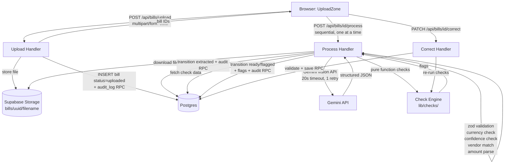
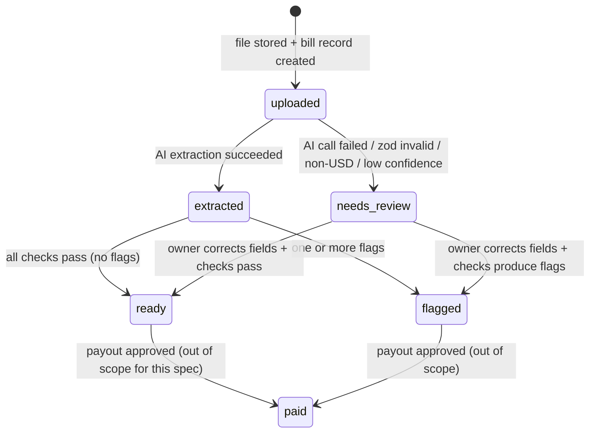

# Design Document

## Overview

The invoice-processing feature is the core pipeline of FleetSpend AI. It covers everything from file upload through AI extraction, business-rule checking, and final status assignment (`ready` or `flagged`). Payments and the approval table are explicitly out of scope.

The pipeline runs server-side in Next.js API route handlers deployed on Vercel serverless functions. Persistent state lives entirely in Supabase (Postgres + Storage). The Gemini vision API extracts structured data from bill images and PDFs; a zod schema validates every response before any field is trusted. Four pure-function checks (duplicate, overcharge, new-payee, policy-limit) each produce a `Flag | null` result that is collected and used to assign the final bill status. Every status transition is written atomically with an `audit_log` row via a Postgres RPC function.

### Key Constraints

- Money is **never** a float; all amounts are stored and computed as integer minor units (cents for USD).
- The AI never moves money; every payout requires explicit human approval (enforced in a separate spec).
- A bill can never be paid twice; idempotency is enforced at the database layer.
- All secrets stay server-side. Nothing sensitive reaches the browser or logs.
- Demo mode requires zero setup: seed data provides historical context so all four checks trigger correctly on the eight sample bills.

---

## Architecture

The feature follows a **request-driven, serverless pipeline** pattern. There is no background job worker; processing is triggered by sequential API calls from the client after upload.



### Deployment Topology

- **Next.js API routes** run as Vercel serverless functions (stateless, short-lived).
- **Supabase** provides Postgres (data + RPC) and Storage (file objects). All DB calls use the server-side Supabase client with the service role key — never the anon key for write operations.
- **Gemini API** is called directly from the process handler with a 20-second timeout and one retry.
- No queues, no background workers — sequential processing is enforced client-side (each `process` call waits for the previous to finish before issuing the next).

---

## Components and Interfaces

### API Routes

#### `POST /api/bills/upload`

Accepts `multipart/form-data`. Validates each file, stores it, and creates the bill record.

**Request:** `multipart/form-data` with one or more file fields, max 20 files, 100 MB combined.

**Per-file validation:**
- MIME type must be `image/jpeg`, `image/png`, or `application/pdf`
- File size must be ≤ 10 MB

**Success response (HTTP 200):**
```json
{
  "results": [
    { "filename": "invoice.pdf", "billId": "uuid", "status": "uploaded" },
    { "filename": "bad.gif", "error": "Unsupported file type: image/gif" }
  ]
}
```

**Implementation notes:**
- Uses Next.js `request.formData()` to parse the multipart body.
- Files are processed in order; each stores independently. A failure on one file does not abort the others.
- Storage path: `bills/{uuid}/{original_filename}` where `uuid` is freshly generated per file.
- If Storage write succeeds but DB write fails: delete the stored file, return an error for that file.
- If Storage write fails: return an error for that file, no DB record created.
- On success: calls the `create_bill(storage_path, original_filename)` RPC which inserts the bill and writes the audit_log atomically.

#### `POST /api/bills/[id]/process`

Triggered by the client sequentially after upload. Runs the full extraction and check pipeline for one bill.

**Request:** no body required (bill ID from path).

**Idempotency:** If the bill's current status is NOT `uploaded` when the process route is called, the handler returns the bill's current status and existing flags immediately without calling Gemini. This prevents re-processing a bill that was already extracted or is in needs_review.

**Response:**
- Bill was `uploaded`: runs the full pipeline, returns `{ billId, status, flags?: Flag[] }` or `{ billId, status: "needs_review", error: string }`.
- Bill was already processed (status ≠ `uploaded`): returns `{ billId, status, flags?: Flag[], skipped: true }`.

**Processing steps:**
0. **Idempotency check:** Load the bill record. If `status !== 'uploaded'`, return the current status and flags immediately — do not proceed further.

#### `PATCH /api/bills/[id]/correct`

Accepts corrected field values for a `needs_review` bill.

**Request body:**
```typescript
{
  vendor_name?: string;        // non-empty, max 255 chars
  vendor_id?: string;          // UUID of selected existing vendor, or null for new
  currency_code?: string;      // must be valid ISO 4217, must be "USD"
  amount?: string;             // decimal string e.g. "125.50"
  bill_date?: string;          // YYYY-MM-DD
  invoice_number?: string;     // optional
  payee_email?: string;        // optional
}
```

**Validation rules:**
- `vendor_name`: non-empty, ≤ 255 characters
- `currency_code`: valid ISO 4217 alphabetic code AND must be `USD`
- `amount`: positive decimal, at most 2 decimal places; converts to minor units in range 1–999,999,999
- `bill_date`: calendar-valid YYYY-MM-DD

**On success:** calls `save_field_corrections` RPC, then re-runs the check engine, then calls `complete_checks(bill_id, flags)` RPC. If the request includes `vendor_name` but no `vendor_id` (or `vendor_id` is null), the handler calls `matchOrCreateVendor(vendor_name, supabase)` to resolve or create the vendor before saving corrections. If `vendor_id` is provided, it is used directly without re-matching.

#### `POST /api/demo/reset`

Only active when `DEMO_MODE=true`. Calls the `reset_demo()` Postgres RPC function. Checks `process.env.DEMO_MODE === 'true'` (returns 403 if false), deletes all Storage objects in the `bills` bucket, then calls the `reset_demo()` RPC.

**Response:** `{ success: true }` or `{ error: string }`.

---

### lib/ai/

#### `extractionSchema` (zod)

```typescript
const extractionSchema = z.object({
  vendor_name: z.string().min(1),
  payee_email: z.string().email().nullable().optional(),
  amount_text: z.string().min(1),         // e.g. "1,250.50" — never converted here
  currency_code: z.string().length(3),
  bill_date: z.string().regex(/^\d{4}-\d{2}-\d{2}$/),
  invoice_number: z.string().nullable().optional(),
  category: z.string().min(1),
  confidence: z.object({
    vendor_name: z.number().min(0).max(1),
    payee_email: z.number().min(0).max(1).optional(),
    amount_text: z.number().min(0).max(1),
    currency_code: z.number().min(0).max(1),
    bill_date: z.number().min(0).max(1),
    invoice_number: z.number().min(0).max(1).optional(),
    category: z.number().min(0).max(1),
  }),
});

type Extraction = z.infer<typeof extractionSchema>;
```

#### `extractBill(fileBuffer: Buffer, mimeType: string): Promise<Extraction>`

1. Sends `fileBuffer` as an inline part to the Gemini model identified by `process.env.GEMINI_MODEL`.
2. Configures the Gemini request with `responseMimeType: "application/json"` and a `responseSchema` that matches the extraction schema shape, in addition to the prompt. This uses Gemini's native JSON mode to reduce parsing failures.
3. Zod validation is still performed on the response even when JSON mode is active, as a second layer of defence.
4. Sets a 20-second timeout via `AbortController`.
5. On timeout or network error: waits 5 seconds, retries once.
6. On success: parses the response text as JSON, validates with `extractionSchema`.
7. Throws a typed error (`GeminiTimeoutError | GeminiServiceError | ZodValidationError`) on any failure.

**Prompt template (inline in `lib/ai/prompt.ts`):**
```
You are a bill extraction assistant. Extract the following fields from the attached bill image or PDF.
Return ONLY valid JSON matching this exact schema — no markdown fences, no explanation.

{
  "vendor_name": "string — the payee business name as printed",
  "payee_email": "string | null — PayPal or payment email if visible, else null",
  "amount_text": "string — the total amount exactly as printed (e.g. \"1,250.50\")",
  "currency_code": "string — ISO 4217 three-letter code (e.g. \"USD\")",
  "bill_date": "string — YYYY-MM-DD format",
  "invoice_number": "string | null — invoice or reference number if present, else null",
  "category": "string — one of: fuel, repair, parts, driver_trip, other",
  "confidence": {
    "vendor_name": 0.0–1.0,
    "payee_email": 0.0–1.0,
    "amount_text": 0.0–1.0,
    "currency_code": 0.0–1.0,
    "bill_date": 0.0–1.0,
    "invoice_number": 0.0–1.0,
    "category": 0.0–1.0
  }
}

Round all confidence scores to two decimal places.
```

> **Gemini JSON mode:** The API call sets `generationConfig: { responseMimeType: "application/json", responseSchema: { ... } }` alongside the prompt. The `responseSchema` mirrors the zod schema structure but uses Gemini's schema format (OpenAPI-compatible). Zod re-validates the parsed JSON regardless.

---

### lib/money/

#### `parseAmountText(amountText: string, currencyCode: string): number`

- Strips thousands-separator commas.
- Validates remaining string matches `/^\d+(\.\d{0,2})?$/` for 2-decimal currencies (USD).
- Multiplies by 100, rounds to nearest integer (no float intermediate — multiply string parts separately).
- Throws `InvalidAmountError` if the string is not a valid decimal, has more than 2 decimal places, or would produce a value outside 1–999,999,999.

**Algorithm (avoids float precision loss):**
```typescript
function parseAmountText(amountText: string, _currencyCode: string): number {
  const cleaned = amountText.replace(/,/g, '');
  const match = cleaned.match(/^(\d+)(?:\.(\d{1,2}))?$/);
  if (!match) throw new InvalidAmountError(amountText);
  const whole = parseInt(match[1], 10);
  const frac = match[2] ? match[2].padEnd(2, '0') : '00';
  const result = whole * 100 + parseInt(frac, 10);
  if (result < 1 || result > 999_999_999) throw new InvalidAmountError(amountText);
  return result;
}
```

#### `formatCurrency(minorUnits: number): string`

```typescript
function formatCurrency(minorUnits: number): string {
  const dollars = Math.floor(minorUnits / 100);
  const cents = minorUnits % 100;
  return `$${dollars.toLocaleString('en-US')}.${String(cents).padStart(2, '0')}`;
}
```

Used exclusively for display; never used in arithmetic comparisons.

---

### lib/checks/

All four checks are pure functions — they take pre-fetched data and return `Flag | null`. No database calls inside.

```typescript
type Flag = {
  check_name: 'duplicate' | 'overcharge' | 'new_payee' | 'policy_limit';
  reason: string;
};
```

#### `checkDuplicate(bill: BillForCheck, existingBills: ExistingBill[]): Flag | null`

```typescript
type BillForCheck = {
  id: string;
  vendor_id: string;
  invoice_number: string | null;
  amount_minor_units: number;
  bill_date: string;
};

type ExistingBill = {
  id: string;
  vendor_id: string;
  invoice_number: string | null;
  amount_minor_units: number;
  bill_date: string;
  // for flag reason display:
  invoice_number_display: string | null;
  vendor_name: string;
};
```

Logic:
1. Filter `existingBills` to exclude entries where `existing.id === bill.id`.
2. Match set A: `existing.vendor_id === bill.vendor_id && existing.invoice_number !== null && existing.invoice_number === bill.invoice_number`.
3. Match set B: `existing.vendor_id === bill.vendor_id && existing.amount_minor_units === bill.amount_minor_units && existing.bill_date === bill.bill_date`.
4. Union A ∪ B; if empty → return `null`.
5. Find earliest match by `bill_date` (lexicographic sort on YYYY-MM-DD is correct for dates).
6. Return flag: `"Possible duplicate of invoice [invoice_number] from [vendor_name] on [bill_date]."`.

#### `checkOvercharge(bill: { amount_minor_units: number; vendor_name: string }, history: { count: number; sum: number }): Flag | null`

```typescript
// Threshold: amount * count > 2 * sum  (BigInt arithmetic to avoid integer overflow)
if (history.count < 2) return null;
if (BigInt(bill.amount_minor_units) * BigInt(history.count) > 2n * BigInt(history.sum)) {
  const average = Math.round(history.sum / history.count); // for display only
  return {
    check_name: 'overcharge',
    reason: `Amount of ${formatCurrency(bill.amount_minor_units)} is more than 2x the usual ${formatCurrency(average)} average for ${bill.vendor_name}.`,
  };
}
return null;
```

Note: `sum / count` is computed only to format the display average — never used in the comparison threshold. The threshold `BigInt(amount) * BigInt(count) > 2n * BigInt(sum)` uses BigInt arithmetic to avoid integer overflow for large values.

#### `checkNewPayee(vendorId: string, paidVendorIds: Set<string>): Flag | null`

```typescript
if (!paidVendorIds.has(vendorId)) {
  return { check_name: 'new_payee', reason: `First-time payee: [vendor_name] has no payment history.` };
}
return null;
```

The caller supplies `vendor_name` via a separate lookup; the function signature accepts it as a parameter for the reason string.

#### `checkPolicyLimit(amount: number, limit: number | null): Flag | null`

```typescript
if (limit === null) return null; // check disabled
if (amount > limit) {
  return {
    check_name: 'policy_limit',
    reason: `Amount of ${formatCurrency(amount)} is above your per-bill limit of ${formatCurrency(limit)}.`,
  };
}
return null;
```

`limit` is `null` when `POLICY_LIMIT_MINOR_UNITS` is absent, zero, negative, or non-integer.

---

### lib/vendors/

#### `normalizeVendorName(name: string): string`

```typescript
// 1. Lowercase
// 2. Trim leading/trailing whitespace
// 3. Remove all punctuation characters (regex: /[^\w\s]/g → '')
// 4. Expand "stn" → "station" (word boundary match: /\bstn\b/g)
// 5. Strip legal/common suffixes: /\b(co|company|inc|ltd|llc)\b/g → ''
// 6. Collapse multiple spaces to one
// 7. Trim again
```

**Suffix handling order matters:** expand "stn" before stripping suffixes so "stn" is never accidentally stripped as a suffix.

**Example-based tests (in unit tests):**
- `normalizeVendorName("City Lube Stn.")` → `"city lube station"` (punctuation removed, stn expanded)
- `normalizeVendorName("City Lube Station")` → `"city lube station"` (already expanded — both match)
- `normalizeVendorName("Apex Fuel Company")` → `"apex fuel"` (company stripped)
- `normalizeVendorName("Apex Fuel Co")` → `"apex fuel"` (co stripped — both match)
- `normalizeVendorName("Metro Auto Repair Inc.")` → `"metro auto repair"` (punctuation + inc stripped)

#### `matchOrCreateVendor(extractedName: string, supabase: SupabaseClient): Promise<{ vendorId: string }>`

1. Normalize `extractedName` → `normalizedName`.
2. Query `vendors` by `normalized_name = normalizedName`.
3. If found: return `{ vendorId: vendor.id }`.
4. If not found: INSERT new vendor with `name = extractedName`, `normalized_name = normalizedName`, `category = null`, `paypal_email = null`.
5. Return `{ vendorId: newVendor.id }`.

---

### lib/db/

```typescript
// Read operations
getBillById(id: string): Promise<Bill>
getBillsForDuplicateCheck(vendorId: string): Promise<ExistingBill[]>
  // WHERE vendor_id = $1 AND status NOT IN ('uploaded', 'needs_review')
getOverchargeHistory(vendorId: string, currencyCode: string): Promise<{ count: number; sum: number }>
  // SELECT COUNT(*), SUM(amount_minor_units) WHERE vendor_id=$1 AND currency_code=$2 AND status='paid'
getPaidVendorIds(): Promise<Set<string>>
  // SELECT DISTINCT vendor_id WHERE status='paid'
getVendorByNormalizedName(normalizedName: string): Promise<Vendor | null>

// Write operations (all writes go through RPC, not direct table mutations)
// Note: bill creation is handled entirely by the create_bill() RPC — no direct INSERT from app code.
createVendor(fields: NewVendor): Promise<Vendor>
```

---

### UI Components

#### `UploadZone`

- Drag-and-drop area + "Browse" button.
- Accepts `image/jpeg`, `image/png`, `application/pdf`.
- Client-side pre-validation (MIME type and 10 MB size) before sending.
- Shows per-file upload progress (indeterminate spinner per file).
- After all uploads complete, sequentially calls `POST /api/bills/[id]/process` for each successful bill, waiting for each to finish before starting the next.
- Shows inline result per file: status badge + flag summary if flagged, or error message.

#### `BillReviewForm`

- Rendered for bills with status `needs_review`.
- Pre-fills all extracted fields from the bill record.
- Fields with a `confidence < 0.8` score are visually highlighted (e.g., amber border + warning icon).
- Vendor field: dropdown populated from existing vendors + "New vendor" option.
- Amount field: decimal string input (e.g., `"125.50"`), not minor units.
- On submit: calls `PATCH /api/bills/[id]/correct`.
- Displays field-level validation errors returned by the API.

#### `BillStatusBadge`

```
uploaded      → gray
extracted     → blue
needs_review  → amber
ready         → green
flagged       → red
paid          → teal
```

#### `ResetDemoButton`

- Only rendered when `DEMO_MODE=true` (checked server-side via env, passed as a prop or via server component).
- Shows a confirmation dialog before calling `POST /api/demo/reset`.
- On success: redirects to the upload page.

---

## Data Models

### Database Schema

#### `vendors`

```sql
CREATE TABLE vendors (
  id               UUID PRIMARY KEY DEFAULT gen_random_uuid(),
  name             TEXT NOT NULL,
  normalized_name  TEXT NOT NULL UNIQUE,
  paypal_email     TEXT,
  category         TEXT,
  created_at       TIMESTAMPTZ NOT NULL DEFAULT now()
);

CREATE INDEX idx_vendors_normalized_name ON vendors (normalized_name);
```

#### `bills`

```sql
CREATE TABLE bills (
  id                    UUID PRIMARY KEY DEFAULT gen_random_uuid(),
  vendor_id             UUID REFERENCES vendors(id),
  storage_path          TEXT NOT NULL,
  original_filename     TEXT NOT NULL,
  status                TEXT NOT NULL CHECK (status IN (
                          'uploaded', 'extracted', 'needs_review',
                          'ready', 'flagged', 'paid'
                        )),
  vendor_name_raw       TEXT,
  amount_text           TEXT,
  amount_minor_units    INTEGER,
  currency_code         TEXT,
  bill_date             DATE,
  invoice_number        TEXT,
  payee_email           TEXT,
  category              TEXT,
  confidence            JSONB,
  low_confidence_fields TEXT[],
  created_at            TIMESTAMPTZ NOT NULL DEFAULT now(),
  updated_at            TIMESTAMPTZ NOT NULL DEFAULT now()
);

CREATE INDEX idx_bills_vendor_id   ON bills (vendor_id);
CREATE INDEX idx_bills_status      ON bills (status);
CREATE INDEX idx_bills_vendor_status ON bills (vendor_id, status);
```

The `updated_at` column is maintained by a simple trigger that sets it to `now()` on every row update.

#### `flags`

```sql
CREATE TABLE flags (
  id          UUID PRIMARY KEY DEFAULT gen_random_uuid(),
  bill_id     UUID NOT NULL REFERENCES bills(id) ON DELETE CASCADE,
  check_name  TEXT NOT NULL CHECK (check_name IN (
                'duplicate', 'overcharge', 'new_payee', 'policy_limit'
              )),
  reason      TEXT NOT NULL,
  created_at  TIMESTAMPTZ NOT NULL DEFAULT now()
);

CREATE INDEX idx_flags_bill_id ON flags (bill_id);
```

#### `audit_log`

```sql
CREATE TABLE audit_log (
  id           UUID PRIMARY KEY DEFAULT gen_random_uuid(),
  bill_id      UUID REFERENCES bills(id),    -- nullable (future: non-bill events)
  event        TEXT NOT NULL,                -- 'status_transition' | 'field_corrected'
  prev_status  TEXT,
  new_status   TEXT,
  actor        TEXT NOT NULL DEFAULT 'system',
  metadata     JSONB,                        -- flag check names, corrected fields, etc.
  created_at   TIMESTAMPTZ NOT NULL DEFAULT now()
);

CREATE INDEX idx_audit_log_bill_id ON audit_log (bill_id);
```

**Append-only enforcement:** A `BEFORE UPDATE OR DELETE` trigger on `audit_log` raises an exception unconditionally. The `reset_demo()` SECURITY DEFINER function bypasses row-level triggers via `TRUNCATE` (which is a DDL statement, not a DML row event).

### Row Level Security

Row Level Security (RLS) is enabled on all four tables. No application-level policies are created — only the server-side service role can access these tables. All API routes use the Supabase client initialized with `SUPABASE_SERVICE_ROLE_KEY` (server-side only).

```sql
-- Enable RLS (no policies = no access except service role)
ALTER TABLE vendors   ENABLE ROW LEVEL SECURITY;
ALTER TABLE bills     ENABLE ROW LEVEL SECURITY;
ALTER TABLE flags     ENABLE ROW LEVEL SECURITY;
ALTER TABLE audit_log ENABLE ROW LEVEL SECURITY;
```

**RPC function permissions:** Every RPC function has `EXECUTE` revoked from `public`, `anon`, and `authenticated`, and granted only to `service_role`:

```sql
REVOKE EXECUTE ON FUNCTION transition_bill_status(UUID, TEXT, JSONB) FROM PUBLIC, anon, authenticated;
GRANT  EXECUTE ON FUNCTION transition_bill_status(UUID, TEXT, JSONB) TO   service_role;

REVOKE EXECUTE ON FUNCTION save_extraction(UUID, JSONB, UUID, TEXT, TEXT[], TEXT) FROM PUBLIC, anon, authenticated;
GRANT  EXECUTE ON FUNCTION save_extraction(UUID, JSONB, UUID, TEXT, TEXT[], TEXT) TO   service_role;

REVOKE EXECUTE ON FUNCTION save_field_corrections(UUID, JSONB, TEXT) FROM PUBLIC, anon, authenticated;
GRANT  EXECUTE ON FUNCTION save_field_corrections(UUID, JSONB, TEXT) TO   service_role;

REVOKE EXECUTE ON FUNCTION complete_checks(UUID, JSONB) FROM PUBLIC, anon, authenticated;
GRANT  EXECUTE ON FUNCTION complete_checks(UUID, JSONB) TO   service_role;

REVOKE EXECUTE ON FUNCTION create_bill(TEXT, TEXT) FROM PUBLIC, anon, authenticated;
GRANT  EXECUTE ON FUNCTION create_bill(TEXT, TEXT) TO   service_role;

REVOKE EXECUTE ON FUNCTION reset_demo() FROM PUBLIC, anon, authenticated;
GRANT  EXECUTE ON FUNCTION reset_demo() TO   service_role;

REVOKE EXECUTE ON FUNCTION seed_demo_data() FROM PUBLIC, anon, authenticated;
GRANT  EXECUTE ON FUNCTION seed_demo_data() TO   service_role;
```

**Storage:** The `bills` bucket is created as private (`public = false`). Files are only accessed server-side using a signed URL generated with the service role key. No public download URLs are ever issued.

### Postgres RPC Functions

#### `transition_bill_status(p_bill_id UUID, p_new_status TEXT, p_metadata JSONB DEFAULT '{}')`

Validates that the transition is permitted by the state machine before applying it.

```sql
CREATE OR REPLACE FUNCTION transition_bill_status(
  p_bill_id    UUID,
  p_new_status TEXT,
  p_metadata   JSONB DEFAULT '{}'
) RETURNS void
LANGUAGE plpgsql
AS $$
DECLARE
  v_prev_status TEXT;
BEGIN
  SELECT status INTO v_prev_status FROM bills WHERE id = p_bill_id FOR UPDATE;
  IF NOT FOUND THEN
    RAISE EXCEPTION 'Bill % not found', p_bill_id;
  END IF;

  -- State machine validation
  IF NOT (
    (v_prev_status = 'uploaded'      AND p_new_status IN ('extracted', 'needs_review')) OR
    (v_prev_status = 'extracted'     AND p_new_status IN ('ready', 'flagged'))           OR
    (v_prev_status = 'needs_review'  AND p_new_status IN ('ready', 'flagged'))           OR
    (v_prev_status = 'ready'         AND p_new_status = 'paid')                          OR
    (v_prev_status = 'flagged'       AND p_new_status = 'paid')
  ) THEN
    RAISE EXCEPTION 'Invalid status transition: % → %', v_prev_status, p_new_status;
  END IF;

  UPDATE bills SET status = p_new_status, updated_at = now() WHERE id = p_bill_id;

  INSERT INTO audit_log (bill_id, event, prev_status, new_status, actor, metadata)
  VALUES (p_bill_id, 'status_transition', v_prev_status, p_new_status, 'system', p_metadata);
END;
$$;
```

#### `create_bill(p_storage_path TEXT, p_original_filename TEXT) RETURNS UUID`

Inserts a new bill with status `uploaded` and writes its audit_log row atomically.

```sql
CREATE OR REPLACE FUNCTION create_bill(
  p_storage_path      TEXT,
  p_original_filename TEXT
) RETURNS UUID
LANGUAGE plpgsql
AS $$
DECLARE
  v_bill_id UUID;
BEGIN
  INSERT INTO bills (storage_path, original_filename, status)
  VALUES (p_storage_path, p_original_filename, 'uploaded')
  RETURNING id INTO v_bill_id;

  INSERT INTO audit_log (bill_id, event, prev_status, new_status, actor)
  VALUES (v_bill_id, 'status_transition', NULL, 'uploaded', 'system');

  RETURN v_bill_id;
END;
$$;
```

#### `save_extraction(p_bill_id UUID, p_fields JSONB, p_vendor_id UUID, p_new_status TEXT, p_low_confidence_fields TEXT[], p_message TEXT DEFAULT NULL) RETURNS void`

Saves extracted fields (or partial fields for needs_review), sets vendor_id, and transitions status atomically. For `needs_review` bills, all extracted fields are still persisted so the review form can be pre-filled.

```sql
CREATE OR REPLACE FUNCTION save_extraction(
  p_bill_id               UUID,
  p_fields                JSONB,
  p_vendor_id             UUID,
  p_new_status            TEXT,   -- 'extracted' or 'needs_review'
  p_low_confidence_fields TEXT[],
  p_message               TEXT DEFAULT NULL
) RETURNS void
LANGUAGE plpgsql
AS $$
DECLARE
  v_prev_status TEXT;
BEGIN
  SELECT status INTO v_prev_status FROM bills WHERE id = p_bill_id FOR UPDATE;
  IF NOT FOUND THEN RAISE EXCEPTION 'Bill % not found', p_bill_id; END IF;

  -- Allow only uploaded → extracted or uploaded → needs_review
  IF v_prev_status <> 'uploaded' THEN
    RAISE EXCEPTION 'save_extraction requires status=uploaded, got %', v_prev_status;
  END IF;
  IF p_new_status NOT IN ('extracted', 'needs_review') THEN
    RAISE EXCEPTION 'save_extraction: invalid target status %', p_new_status;
  END IF;

  UPDATE bills SET
    vendor_id             = p_vendor_id,
    vendor_name_raw       = p_fields->>'vendor_name',
    amount_text           = p_fields->>'amount_text',
    amount_minor_units    = (p_fields->>'amount_minor_units')::INTEGER,
    currency_code         = p_fields->>'currency_code',
    bill_date             = (p_fields->>'bill_date')::DATE,
    invoice_number        = p_fields->>'invoice_number',
    payee_email           = p_fields->>'payee_email',
    category              = p_fields->>'category',
    confidence            = p_fields->'confidence',
    low_confidence_fields = p_low_confidence_fields,
    status                = p_new_status,
    updated_at            = now()
  WHERE id = p_bill_id;

  INSERT INTO audit_log (bill_id, event, prev_status, new_status, actor, metadata)
  VALUES (
    p_bill_id, 'status_transition', v_prev_status, p_new_status, 'system',
    jsonb_build_object('message', p_message, 'low_confidence_fields', to_jsonb(p_low_confidence_fields))
  );
END;
$$;
```

> **Empty fields on failure:** When called for a timeout or service error (before any extraction succeeded), `p_fields` is passed as `'{}'` (empty JSONB object). All extracted columns in `bills` will be set to `NULL` for those fields via `COALESCE`. The bill is still linked to `vendor_id = NULL` for these failure cases.

#### `complete_checks(p_bill_id UUID, p_flags JSONB) RETURNS void`

Deletes any existing flags for the bill, inserts the new flags, and transitions status to `ready` or `flagged` atomically.

```sql
CREATE OR REPLACE FUNCTION complete_checks(
  p_bill_id UUID,
  p_flags   JSONB    -- array of {check_name, reason} objects; empty array = ready
) RETURNS void
LANGUAGE plpgsql
AS $$
DECLARE
  v_prev_status TEXT;
  v_new_status  TEXT;
  v_flag        JSONB;
  v_flag_names  TEXT[];
BEGIN
  SELECT status INTO v_prev_status FROM bills WHERE id = p_bill_id FOR UPDATE;
  IF NOT FOUND THEN RAISE EXCEPTION 'Bill % not found', p_bill_id; END IF;

  IF v_prev_status NOT IN ('extracted', 'needs_review') THEN
    RAISE EXCEPTION 'complete_checks requires status extracted or needs_review, got %', v_prev_status;
  END IF;

  -- Delete old flags (idempotent re-run support)
  DELETE FROM flags WHERE bill_id = p_bill_id;

  -- Insert new flags
  FOR v_flag IN SELECT * FROM jsonb_array_elements(p_flags)
  LOOP
    INSERT INTO flags (bill_id, check_name, reason)
    VALUES (p_bill_id, v_flag->>'check_name', v_flag->>'reason');
    v_flag_names := array_append(v_flag_names, v_flag->>'check_name');
  END LOOP;

  v_new_status := CASE WHEN jsonb_array_length(p_flags) = 0 THEN 'ready' ELSE 'flagged' END;

  UPDATE bills SET status = v_new_status, updated_at = now() WHERE id = p_bill_id;

  INSERT INTO audit_log (bill_id, event, prev_status, new_status, actor, metadata)
  VALUES (
    p_bill_id, 'status_transition', v_prev_status, v_new_status, 'system',
    jsonb_build_object('flags', v_flag_names)
  );
END;
$$;
```

#### `save_field_corrections(p_bill_id UUID, p_corrections JSONB, p_actor TEXT DEFAULT 'demo_owner')`

```sql
CREATE OR REPLACE FUNCTION save_field_corrections(
  p_bill_id    UUID,
  p_corrections JSONB,
  p_actor      TEXT DEFAULT 'demo_owner'
) RETURNS void
LANGUAGE plpgsql
AS $$
DECLARE
  v_current_status TEXT;
BEGIN
  SELECT status INTO v_current_status FROM bills WHERE id = p_bill_id FOR UPDATE;
  IF NOT FOUND THEN
    RAISE EXCEPTION 'Bill % not found', p_bill_id;
  END IF;

  IF v_current_status <> 'needs_review' THEN
    RAISE EXCEPTION 'save_field_corrections requires status=needs_review, got %', v_current_status;
  END IF;

  UPDATE bills
  SET
    vendor_name_raw    = COALESCE((p_corrections->>'vendor_name'),                 vendor_name_raw),
    currency_code      = COALESCE((p_corrections->>'currency_code'),               currency_code),
    amount_text        = COALESCE((p_corrections->>'amount_text'),                 amount_text),
    amount_minor_units = COALESCE((p_corrections->>'amount_minor_units')::INTEGER, amount_minor_units),
    bill_date          = COALESCE((p_corrections->>'bill_date')::DATE,             bill_date),
    invoice_number     = COALESCE((p_corrections->>'invoice_number'),              invoice_number),
    payee_email        = COALESCE((p_corrections->>'payee_email'),                 payee_email),
    vendor_id          = COALESCE((p_corrections->>'vendor_id')::UUID,             vendor_id),
    updated_at         = now()
  WHERE id = p_bill_id;

  INSERT INTO audit_log (bill_id, event, actor, metadata)
  VALUES (p_bill_id, 'field_corrected', p_actor, p_corrections);
END;
$$;
```

#### `reset_demo()`

Called only from `POST /api/demo/reset` after the API route has already verified `process.env.DEMO_MODE === 'true'` and deleted all Storage objects. The function does not need to check `DEMO_MODE` itself — the guard is in the application layer.

```sql
CREATE OR REPLACE FUNCTION reset_demo()
RETURNS void
LANGUAGE plpgsql
SECURITY DEFINER
SET search_path = public
AS $$
BEGIN
  TRUNCATE audit_log, flags, bills, vendors RESTART IDENTITY CASCADE;
  PERFORM seed_demo_data();
END;
$$;
```

#### `seed_demo_data()`

A standalone function that contains all seed INSERT statements for the 5 vendors and their 15 paid bills. This is the single source of truth for seed data — `supabase/seed.sql` calls this function rather than containing its own INSERT statements:

> **Note:** `seed_demo_data()` is called from within `reset_demo()` (SECURITY DEFINER). `reset_demo()` sets `search_path = public`, so `seed_demo_data()` inherits the safe search path from its caller.

```sql
-- supabase/seed.sql
SELECT seed_demo_data();
```

```sql
CREATE OR REPLACE FUNCTION seed_demo_data()
RETURNS void
LANGUAGE plpgsql
AS $$
BEGIN
  -- Insert 5 vendors
  INSERT INTO vendors (name, normalized_name, paypal_email, category) VALUES
    ('Apex Fuel Co',        'apex fuel',          'apex-fuel@example.com',    'fuel'),
    ('Metro Auto Repair',   'metro auto repair',  'metro-repair@example.com', 'repair'),
    ('ProParts Supply',     'proparts supply',    'proparts@example.com',     'parts'),
    ('Driver Direct Ltd',   'driver direct',      'driver-direct@example.com','driver_trip'),
    ('City Lube Station',   'city lube station',  'city-lube@example.com',    'other')
  ON CONFLICT (normalized_name) DO NOTHING;

  -- Insert 15 paid bills (3 per vendor) using the vendor IDs just inserted
  -- ... full INSERT statements with dates in 2025-11-01 to 2026-10-31 range ...
  -- (See Seed Data Design section for exact values)
END;
$$;
```

**`POST /api/demo/reset` flow:**
1. Check `process.env.DEMO_MODE === 'true'`; if not, return 403.
2. Delete all objects in the `bills` Storage bucket using the service role client.
3. Call `reset_demo()` via Supabase RPC.
4. Return `{ success: true }`.

#### Append-Only Trigger

```sql
CREATE OR REPLACE FUNCTION audit_log_immutable()
RETURNS trigger
LANGUAGE plpgsql
AS $$
BEGIN
  RAISE EXCEPTION 'audit_log rows are immutable: UPDATE and DELETE are not permitted';
END;
$$;

CREATE TRIGGER trg_audit_log_immutable
BEFORE UPDATE OR DELETE ON audit_log
FOR EACH ROW EXECUTE FUNCTION audit_log_immutable();
```

### Bill Status State Machine



---

## Correctness Properties

*A property is a characteristic or behavior that should hold true across all valid executions of a system — essentially, a formal statement about what the system should do. Properties serve as the bridge between human-readable specifications and machine-verifiable correctness guarantees.*

### Property 1: Duplicate check — no flag when no match exists

*For any* bill and any list of existing bills (excluding the bill itself) where no entry shares (`vendor_id` + `invoice_number`) AND no entry shares (`vendor_id` + `amount_minor_units` + `bill_date`), the duplicate check SHALL return `null`.

**Validates: Requirements 5.1, 5.2, 5.5, 5.6**

### Property 2: Overcharge check — no flag when below threshold

*For any* positive integer bill amount, positive integer count ≥ 2, and positive integer historical sum where `amount * count ≤ 2 * sum`, the overcharge check SHALL return `null`.

**Validates: Requirements 6.1, 6.2, 6.3, 6.4, 6.5**

### Property 3: Overcharge check — flag when above threshold

*For any* positive integer bill amount, positive integer count ≥ 2, and positive integer historical sum where `amount * count > 2 * sum`, the overcharge check SHALL return an `overcharge` flag.

**Validates: Requirements 6.1, 6.2, 6.4, 6.5**

### Property 4: Policy-limit check — correct flag/no-flag based on comparison

*For any* positive integer amount and any positive integer limit: when `amount > limit`, the policy-limit check SHALL return a `policy_limit` flag; when `amount ≤ limit`, it SHALL return `null`.

**Validates: Requirements 8.2, 8.3, 8.4**

### Property 5: New-payee check — flag iff vendor has no paid history

*For any* vendor ID and any set of paid vendor IDs: when the vendor ID is absent from the set the check SHALL return a `new_payee` flag; when it is present the check SHALL return `null`.

**Validates: Requirements 7.1, 7.2, 7.3, 7.4**

### Property 6: Amount conversion round-trip

*For any* valid `amount_text` string (digits, optional thousands-separator commas, optional decimal point with at most 2 decimal places), parsing to minor units and converting back to a formatted decimal string SHALL produce the original numeric value (modulo comma formatting and leading zeros).

**Validates: Requirements 10.6, 2.6**

---

## Error Handling

### Gemini API Failures

| Failure type | Behavior |
|---|---|
| Timeout (>20 s, first attempt) | Wait 5 s, retry once |
| Timeout (second attempt) | Call `save_extraction` with empty fields, `new_status='needs_review'`, message: "AI extraction timed out after 2 attempts." |
| Network / service error (first attempt) | Wait 5 s, retry once |
| Network / service error (second attempt) | Call `save_extraction` with empty fields, `new_status='needs_review'`, message: "AI service error after 2 attempts: [error type]." |
| Invalid JSON / zod failure | Call `save_extraction` with empty fields, `new_status='needs_review'`, message listing each failing field and reason |
| Non-USD currency | Call `save_extraction` with the successfully extracted fields, `new_status='needs_review'`, message: "Only USD bills are supported in this version." |
| Low confidence (any core field < 0.8) | Call `save_extraction` with all extracted fields, `new_status='needs_review'`, `low_confidence_fields` populated |

All `needs_review` transitions go through `save_extraction`, which atomically persists whatever fields were extracted (even if empty) and writes the `audit_log` row. `transition_bill_status` is NOT called for these paths.

### Storage Failures

- **Storage write fails:** Return error for that file. No DB record is created. Continue processing remaining files.
- **DB write fails after Storage write:** Call Supabase Storage `remove()` to delete the uploaded object. Return error for that file. No partial bill record remains.
- **Storage delete fails during cleanup:** Log the orphaned path server-side (without secrets). The bill record is never created. Treat as a storage failure — surface the original DB error to the caller.

### DB / RPC Failures

- All status transitions and their audit rows are in a single Postgres transaction via RPC. If the transaction fails, the bill stays in its previous status and an error is returned to the caller.
- The process handler treats a failed RPC as a non-retryable error and returns a 500 with the bill ID and a human-readable message.

### Batch Isolation

- The upload handler processes each file independently. A rejection or failure on one file does not affect others.
- The client issues process calls sequentially. A process failure for one bill is reported inline; the client continues with the next.

### Correction Validation Failures

- Field-level validation errors are returned immediately without touching the database.
- On partial validation failure: all submitted fields are rejected; no partial update is applied.

### Policy Limit Config Error

- If `POLICY_LIMIT_MINOR_UNITS` is absent, zero, negative, or non-integer at startup: log `[config] POLICY_LIMIT_MINOR_UNITS is invalid or missing — policy-limit check disabled` (server-side only, no secret values). The `checkPolicyLimit` function receives `null` and returns `null` for all bills in the session.

---

## Testing Strategy

### Unit Tests (Vitest)

- `lib/money/parseAmountText` — valid inputs (integers, decimals, comma-separated), invalid inputs (letters, too many decimals, out-of-range), edge cases (0, max value boundary).
- `lib/money/formatCurrency` — known values, boundary cents values (0, 99), large amounts.
- `lib/vendors/normalizeVendorName` — punctuation stripping, suffix removal, whitespace collapsing.
- `lib/checks/*` — example-based tests for each check: one flag scenario, one no-flag scenario, boundary conditions (count = 1 for overcharge, exact-threshold for policy limit, self-exclusion for duplicate).
- API route handlers — tested with mocked Supabase and Gemini clients; verify HTTP status codes, response shapes, and that RPC calls are made with the correct arguments.

### Property-Based Tests (fast-check, in `tests/`)

All properties use fast-check arbitraries and run via Vitest. Minimum 100 iterations per property.

**Property 1 — Duplicate check, no-flag:**
- Arbitrary: `fc.record({ bill: billArb, existingBills: fc.array(existingBillArb) })` filtered so no entry matches either match condition.
- Assert: `checkDuplicate(bill, existingBills) === null`.
- Tag: `Feature: invoice-processing, Property 1: Duplicate check — no flag when no match exists`

**Property 2 — Overcharge, no-flag:**
- Arbitraries:
  - `amount`: `fc.integer({ min: 1, max: 999_999_999 })`
  - `count`: `fc.integer({ min: 2, max: 10_000 })`
  - Construct `sum` from generated per-bill amounts: `fc.array(fc.integer({ min: 1, max: 999_999_999 }), { minLength: count, maxLength: count })` → `sum = perBillAmounts.reduce((a, b) => a + b, 0)` (as BigInt sum). Then scale `amount` down to satisfy the condition: set `amount = Math.floor(Number(2n * BigInt(sum) / BigInt(count)))` so `amount * count ≤ 2 * sum` by construction, clamped to [1, 999_999_999].
  - This constructs values satisfying the no-flag condition rather than filtering.
- Assert: `checkOvercharge({ amount_minor_units: amount, ... }, { count, sum: Number(sum) }) === null`.
- Tag: `Feature: invoice-processing, Property 2: Overcharge check — no flag when below threshold`

**Property 3 — Overcharge, flag:**
- Arbitraries:
  - `amount`: `fc.integer({ min: 1, max: 999_999_999 })`
  - `count`: `fc.integer({ min: 2, max: 10_000 })`
  - Construct `sum` using the same `fc.array` approach (BigInt sum). Then scale `amount` up: set `amount = Math.min(999_999_999, Math.floor(Number(2n * BigInt(sum) / BigInt(count))) + 1)` so `BigInt(amount) * BigInt(count) > 2n * BigInt(sum)` by construction.
  - No `fc.filter` needed — values are constructed to satisfy the condition.
- Assert: `checkOvercharge(...).check_name === 'overcharge'`.
- Note: The BigInt sum may exceed `Number.MAX_SAFE_INTEGER` for large inputs; pass it as BigInt throughout the test and cast only for the history argument: `{ count, sum: Number(bigIntSum) }` is only safe when `bigIntSum ≤ Number.MAX_SAFE_INTEGER`; otherwise use a BigInt-aware history type or cap per-bill amounts so `count * 999_999_999 ≤ Number.MAX_SAFE_INTEGER` (guaranteed when `count ≤ 9_007` for max per-bill amount). For safety, use `fc.integer({ min: 2, max: 9_007 })` for count in this test.
- Tag: `Feature: invoice-processing, Property 3: Overcharge check — flag when above threshold`

**Property 4 — Policy limit:**
- Arbitrary: `fc.tuple(fc.integer({ min: 1 }), fc.integer({ min: 1 }))`.
- Assert: `amount > limit ↔ checkPolicyLimit(amount, limit)?.check_name === 'policy_limit'`.
- Tag: `Feature: invoice-processing, Property 4: Policy-limit check — correct flag/no-flag based on comparison`

**Property 5 — New payee:**
- Arbitrary: `fc.tuple(fc.uuid(), fc.array(fc.uuid()))`.
- Assert: `!paidVendorIds.has(vendorId) ↔ checkNewPayee(vendorId, new Set(paidVendorIds)) !== null`.
- Tag: `Feature: invoice-processing, Property 5: New-payee check — flag iff vendor has no paid history`

**Property 6 — Amount round-trip:**
- Arbitrary: `fc.tuple(fc.integer({ min: 0, max: 9_999_999 }), fc.integer({ min: 0, max: 99 }))` → construct `amount_text = "${dollars}.${String(cents).padStart(2,'0')}"`.
- Assert: `parseAmountText(amountText, 'USD') === dollars * 100 + cents`.
- Tag: `Feature: invoice-processing, Property 6: Amount conversion round-trip`

### Manual Test Checklist

A `docs/manual-test-checklist.md` file documents the end-to-end demo steps for the 8 sample bills. It is not an automated test. The file contains:

- Pre-conditions: seed script run, `DEMO_MODE=true`, `POLICY_LIMIT_MINOR_UNITS=100000` set in `.env.local`, 8 sample images present in `public/samples/`.
- Step-by-step upload and processing instructions for each of the 8 bills, in order: ready-1 through ready-4, then duplicate, overcharge, new-payee, needs-review.
- Expected outcome for each bill: status, flags present/absent, flag reason text.
- Reset demo steps: click Reset Demo, verify redirect to upload page, verify 0 bills shown.

The checklist is created as part of the implementation tasks (see `tasks.md`).

---

## Seed Data Design

### Vendors

| # | Name | Category | PayPal Email | Normalized Name |
|---|------|----------|--------------|-----------------|
| 1 | Apex Fuel Co | fuel | apex-fuel@example.com | apex fuel |
| 2 | Metro Auto Repair | repair | metro-repair@example.com | metro auto repair |
| 3 | ProParts Supply | parts | proparts@example.com | proparts supply |
| 4 | Driver Direct Ltd | driver_trip | driver-direct@example.com | driver direct |
| 5 | City Lube Station | other | city-lube@example.com | city lube station |

### Seeded Paid Bills (minimum 3 per vendor, 15 total)

| Vendor | Invoice # | Amount (USD) | Amount (minor units) | Bill Date |
|--------|-----------|-------------|----------------------|-----------|
| Apex Fuel Co | APX-001 | $220.00 | 22000 | 2025-11-10 |
| Apex Fuel Co | APX-002 | $180.00 | 18000 | 2026-02-05 |
| Apex Fuel Co | APX-003 | $200.00 | 20000 | 2026-06-15 |
| Metro Auto Repair | MAR-001 | $850.00 | 85000 | 2025-11-20 |
| Metro Auto Repair | MAR-002 | $920.00 | 92000 | 2026-03-30 |
| Metro Auto Repair | MAR-003 | $780.00 | 78000 | 2026-08-01 |
| ProParts Supply | PPS-001 | $340.00 | 34000 | 2025-12-12 |
| ProParts Supply | PPS-002 | $310.00 | 31000 | 2026-04-18 |
| ProParts Supply | PPS-003 | $360.00 | 36000 | 2026-09-22 |
| Driver Direct Ltd | DDL-001 | $150.00 | 15000 | 2025-11-05 |
| Driver Direct Ltd | DDL-002 | $175.00 | 17500 | 2026-01-10 |
| Driver Direct Ltd | DDL-003 | $160.00 | 16000 | 2026-07-08 |
| City Lube Station | CLS-001 | $95.00 | 9500 | 2025-12-25 |
| City Lube Station | CLS-002 | $105.00 | 10500 | 2026-05-30 |
| City Lube Station | CLS-003 | $88.00 | 8800 | 2026-10-01 |

### Demo Scenario Verification

#### Overcharge scenario (Apex Fuel Co)

- Seeded paid amounts: 22000 + 18000 + 20000 = **sum = 60000**, **count = 3**
- Threshold formula: `amount * count > 2 * sum` → `amount * 3 > 120000` → `amount > 40000`
- Demo overcharge bill amount: **$450.00 (45000 minor units)**
- Check: `45000 * 3 = 135000 > 120000` ✓ → triggers `overcharge` flag

#### Duplicate scenario (Metro Auto Repair)

- Sample bill `duplicate.jpg` matches vendor **Metro Auto Repair**, invoice number **MAR-002**
- Alternatively matches on: vendor + amount `92000` + date `2026-03-30`
- Either match triggers the duplicate flag

#### New-payee scenario

- Sample bill `new-payee.jpg` extracts a vendor name that does NOT match any of the 5 seeded vendors (e.g., "Highway Diesel Inc").
- No paid bills exist for this vendor → `new_payee` flag triggered.

#### Needs-review scenario

- Sample bill `needs-review.jpg` is a low-quality or partially visible image.
- At least one of `vendor_name`, `amount_text`, `currency_code`, or `bill_date` has a Confidence_Score < 0.8 → bill transitions to `needs_review`.

#### Ready scenarios

- Four sample bills (`ready-1.jpg` through `ready-4.jpg`) each map to distinct seeded vendors (ProParts Supply, Driver Direct Ltd, City Lube Station, and a second Apex Fuel bill within normal range) with amounts that do not trigger any check.
- Example: `ready-1.jpg` → ProParts Supply, $320.00 → within normal range, known vendor, amount within 2× average.

#### Policy limit configuration and per-scenario flag verification

#### Policy limit configuration

`.env.example` sets `POLICY_LIMIT_MINOR_UNITS=100000` ($1,000.00). This means the policy-limit check flags any bill with `amount_minor_units > 100000`.

#### Per-scenario flag verification (with POLICY_LIMIT_MINOR_UNITS=100000)

| Sample bill | Amount | Flags expected | Policy limit triggered? | Notes |
|-------------|--------|----------------|------------------------|-------|
| ready-1.jpg | $320.00 (32000) | none | No (32000 ≤ 100000) | ProParts Supply, within average |
| ready-2.jpg | $160.00 (16000) | none | No (16000 ≤ 100000) | Driver Direct Ltd, within average |
| ready-3.jpg | $90.00 (9000) | none | No (9000 ≤ 100000) | City Lube Station, within average |
| ready-4.jpg | $210.00 (21000) | none | No (21000 ≤ 100000) | Apex Fuel Co, $210 < 2× $200 avg |
| duplicate.jpg | $920.00 (92000) | duplicate | No (92000 ≤ 100000) | Metro Auto Repair MAR-002, exactly same as seed |
| overcharge.jpg | $450.00 (45000) | overcharge | No (45000 ≤ 100000) | Apex Fuel: 45000×3=135000 > 2×60000=120000 ✓ |
| new-payee.jpg | $75.00 (7500) | new_payee | No (7500 ≤ 100000) | "Highway Diesel Inc" — not in seed |
| needs-review.jpg | varies | (blocked at needs_review) | N/A | Low confidence before checks run |

All 6 processable bills (4 ready + duplicate + overcharge) have amounts ≤ $1,000.00, so the policy_limit check produces no extra flags. The demo cleanly demonstrates each scenario without cross-contamination.

### Migration Files

The following files should be created under `supabase/migrations/`:

| File | Contents |
|------|----------|
| `001_create_vendors.sql` | `CREATE TABLE vendors` + `normalized_name` index |
| `002_create_bills.sql` | `CREATE TABLE bills` + status CHECK + indexes + `updated_at` trigger |
| `003_create_flags.sql` | `CREATE TABLE flags` + `bill_id` index |
| `004_create_audit_log.sql` | `CREATE TABLE audit_log` + `bill_id` index + append-only trigger |
| `005_create_rpc_functions.sql` | `transition_bill_status`, `save_extraction`, `save_field_corrections`, `complete_checks`, `create_bill`, `reset_demo`, `seed_demo_data`, append-only trigger; includes `SET search_path = public` on all SECURITY DEFINER functions |
