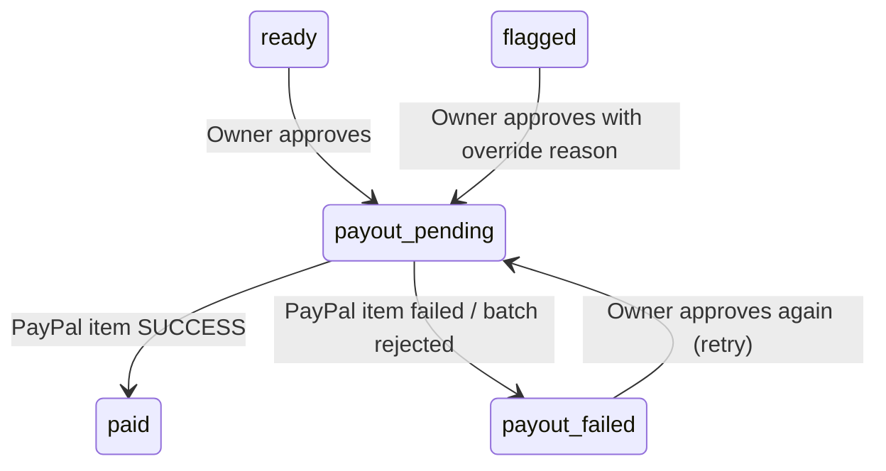

# Design Document

## Overview

This feature turns checked bills into real (sandbox) PayPal payouts with a human in the loop. The Owner selects `ready` bills (and, with a typed reason, `flagged` ones), confirms, and the System creates one **Payout_Batch** atomically in Postgres, sends it to the **PayPal Payouts API**, and keeps item statuses in sync until every item has succeeded or failed. Bills become `paid` only when PayPal reports `SUCCESS` for their item.

Design principles carried over from the steering docs:

- The AI never moves money; only an explicit Owner action creates a batch.
- Money is integer cents everywhere except the single conversion to PayPal's decimal string.
- A bill can never be paid twice: enforced by the bill state machine **and** a partial unique index on payout items **and** PayPal's own idempotency (`sender_batch_id` + `PayPal-Request-Id`).
- PayPal is the source of truth for payment status; the browser never reports success.

```mermaid
sequenceDiagram
    actor Owner
    participant UI as Next.js UI
    participant API as POST /api/payouts
    participant DB as Postgres (RPC)
    participant PP as PayPal Sandbox

    Owner->>UI: select bills, type override reasons, confirm
    UI->>API: { billIds, overrides }
    API->>DB: approve_and_create_batch()  (one transaction)
    DB-->>API: batch id (bills now payout_pending)
    API->>PP: POST /v1/payments/payouts  (PayPal-Request-Id = batch id)
    alt accepted (201)
        PP-->>API: payout_batch_id, PENDING
        API->>DB: mark_batch_submitted()
        API->>PP: GET /v1/payments/payouts/{id}
        PP-->>API: items + transaction_status
        API->>DB: apply_payout_sync()  (success -> paid, failed -> payout_failed)
    else rejected (4xx)
        API->>DB: mark_batch_rejected()  (bills -> payout_failed)
    else timeout / 5xx
        API-->>UI: batch stays "submitting"; a later sync resends the same request
    end
    UI->>API: poll POST /api/payouts/{id}/sync every 5 s (max 2 min)
```

## Bill State Machine (updated)



`ready -> paid` and `flagged -> paid` are removed from `transition_bill_status`; payment status is changed only by the payment RPCs below.

---

## Data Model (migration `008_payment_workflow.sql`)

### `bills` changes

- `status` CHECK constraint adds `payout_pending` and `payout_failed`.
- `transition_bill_status` allowed-transition list updated as above (it no longer allows any `paid` transition; payment RPCs own those).

### `payout_batches`

| Column | Type | Notes |
|---|---|---|
| `id` | uuid PK | also PayPal `sender_batch_id` and `PayPal-Request-Id` |
| `paypal_batch_id` | text NULL, unique | PayPal `payout_batch_id`, set when accepted |
| `status` | text | `submitting`, `failed` (rejected by PayPal), or PayPal's batch_status lower-cased: `pending`, `processing`, `success`, `denied`, `canceled` |
| `item_count` | int | |
| `total_minor_units` | bigint | sum of items |
| `currency_code` | text | `USD` |
| `approved_by` | text | `demo_owner` |
| `error_name`, `error_message` | text NULL | PayPal rejection details |
| `finished` | boolean | true when every item is `success` or `failed` |
| `created_at`, `updated_at` | timestamptz | |

### `payout_items`

| Column | Type | Notes |
|---|---|---|
| `id` | uuid PK | also PayPal `sender_item_id` |
| `batch_id` | uuid FK → payout_batches | |
| `bill_id` | uuid FK → bills | |
| `receiver_email` | text | payee at approval time |
| `amount_minor_units` | int | bill amount at approval time |
| `currency_code` | text | `USD` |
| `note` | text | "Apex Fuel Co · invoice APX-104" |
| `override_reason` | text NULL | required when the bill was flagged |
| `outcome` | text | `queued` → `pending` → `success` / `failed` |
| `paypal_item_id`, `transaction_id`, `transaction_status` | text NULL | from PayPal |
| `error_message` | text NULL | plain-English failure reason |
| `created_at`, `updated_at` | timestamptz | |

```sql
-- At most one live payment per bill (Requirement 4.1)
CREATE UNIQUE INDEX uq_payout_items_live_bill
  ON payout_items (bill_id)
  WHERE outcome IN ('queued', 'pending', 'success');
```

A trigger on `payout_items` rejects DELETE and any outcome change other than `queued→pending|success|failed` and `pending→success|failed` (Requirement 6.3). RLS is enabled on both tables with no policies; all functions are `service_role` only, matching the invoice-processing spec. `audit_log.event` CHECK adds `approved`, `payout_status`, `payout_rejected`.

### RPC functions

| Function | Purpose |
|---|---|
| `approve_and_create_batch(p_bill_ids uuid[], p_overrides jsonb, p_actor text) RETURNS uuid` | Locks the bills (`FOR UPDATE`), validates every rule in Requirement 1 (status, override reason for flagged, payee email, USD, amount, ≤ 50 bills), inserts the batch + items (`outcome='queued'`), moves bills to `payout_pending`, writes `approved` audit rows. Any violation raises `APPROVAL_REJECTED: <bill>: <reason>; …` and nothing is written. |
| `mark_batch_submitted(p_batch_id uuid, p_paypal_batch_id text, p_status text)` | Stores PayPal's batch id/status; items `queued → pending`. |
| `mark_batch_rejected(p_batch_id uuid, p_error_name text, p_error_message text)` | Batch `failed`, all items `failed`, bills `payout_failed`, one `payout_rejected` audit row per bill. |
| `apply_payout_sync(p_batch_id uuid, p_batch_status text, p_items jsonb)` | For each `{sender_item_id, paypal_item_id, transaction_id, transaction_status, outcome, error_message}`: updates the item if its outcome moves forward; on `success` moves the bill `payout_pending → paid`, on `failed` to `payout_failed`, with a `payout_status` audit row containing the transaction id. Sets `finished` when no item is `queued`/`pending`. |

`reset_demo()` is replaced to also truncate `payout_items, payout_batches`.

---

## Components

### `lib/paypal/` (server only)

| Module | Exports |
|---|---|
| `config.ts` | `getPayPalConfig()` → `{ clientId, clientSecret, apiBase }` or `null` when not configured. `apiBase` defaults to `https://api-m.sandbox.paypal.com`; any other host is refused unless it contains `sandbox`. |
| `amount.ts` | `centsToPayPalValue(cents: number): string` — `12550 → "125.50"`, integer math only. |
| `status.ts` | `toItemOutcome(transactionStatus: string \| undefined): 'pending' \| 'success' \| 'failed'` (table in Requirement 3.2). |
| `client.ts` | `createPayPalClient({ config, fetch?, now? })` with `getAccessToken()` (cached until 60 s before expiry), `createPayout(request, requestId)`, `getPayout(paypalBatchId)`. 30 s timeout per call. Throws `PayPalApiError { status, name, message, debugId }` for HTTP errors and `PayPalNetworkError` for timeouts/network failures. Never logs tokens or secrets. |
| `buildPayoutRequest.ts` | `buildPayoutRequest(batch, items)` → PayPal request body (`sender_batch_header` with `sender_batch_id`, `email_subject` "You have a payment from Ridgeway Fleet Services", `email_message`; `items[]` with `recipient_type: 'EMAIL'`, `amount: { value, currency }`, `receiver`, `note`, `sender_item_id`). Pure. |

### `lib/payments/` (business logic, store-injected like `lib/pipeline/`)

```typescript
interface PaymentStore {
  approveAndCreateBatch(billIds: string[], overrides: Record<string, string>, actor: string): Promise<string>; // batch id
  getBatch(batchId: string): Promise<PayoutBatchWithItems>;
  markBatchSubmitted(batchId: string, paypalBatchId: string, status: string): Promise<void>;
  markBatchRejected(batchId: string, errorName: string, errorMessage: string): Promise<void>;
  applyPayoutSync(batchId: string, batchStatus: string, items: SyncedItem[]): Promise<void>;
  listRecentBatches(limit: number): Promise<PayoutBatchSummary[]>;
}
```

- `approveAndPay(input, { store, paypal })` — validates input shape (zod: 1–50 unique UUIDs, override reasons ≤ 500 chars), calls `approveAndCreateBatch`, then `submitBatch`, then `syncBatch`. Returns the batch summary.
- `submitBatch(batchId, deps)` — builds the request from stored items, calls `createPayout` with `requestId = batchId`; 201 → `markBatchSubmitted`; `PayPalApiError` 4xx → `markBatchRejected`; network error / 5xx → leaves `submitting`.
- `syncBatch(batchId, deps)` — finished → return as-is; `submitting` → `submitBatch` again (same request id, safe); otherwise `getPayout` → map each item with `toItemOutcome` → `applyPayoutSync`.
- `ApprovalRejectedError` carries the per-bill problems parsed from `APPROVAL_REJECTED:` for a 409/400 response.

### API routes

| Route | Body / params | Response |
|---|---|---|
| `POST /api/payouts` | `{ billIds: string[], overrides?: Record<billId, reason> }` | 201 `{ batch }`; 400 invalid input; 409 `{ error, problems[] }` approval rejected; 503 PayPal not configured. `maxDuration = 60`. |
| `POST /api/payouts/[batchId]/sync` | — | 200 `{ batch }`; 404 unknown batch. `maxDuration = 60`. |
| `GET /api/payouts` | — | 200 `{ batches }` (10 most recent) |

Webhooks (`PAYMENT.PAYOUTS-ITEM.*`) are an optional later task: they require a public URL and signature verification; polling covers the demo.

### UI

- `BillList` passes bills to a new client component `BillTable` that renders the same rows with a checkbox for selectable statuses (`ready`, `flagged`, `payout_failed`), a sticky action bar "Approve & pay $X to N payees", and an `ApprovalDialog` listing payees, amounts, the total, and an Override_Reason textarea for each flagged bill (with its flag reasons). Submit is disabled while a request is in flight (double-click safe).
- Status display: `payout_pending` → "Paying…" (spinner), `paid` → "Paid" + short transaction id, `payout_failed` → "Payment failed" + reason.
- `PaymentsPanel` (server) lists recent batches; `PayoutPoller` (client) calls the sync endpoint for unfinished batches every 5 s for at most 2 minutes, then `router.refresh()`.
- Summary cards gain "Paid" (total amount).
- If PayPal is not configured, the approve bar shows "PayPal is not configured" and is disabled.

---

## Correctness Properties

### Property 7: PayPal amount conversion is exact
For any integer cents 1..999,999,999, `centsToPayPalValue(c)` matches `^\d+\.\d{2}$` and `parseAmountText(centsToPayPalValue(c), 'USD') === c`.
**Validates: Requirements 2.1, 8.1**

### Property 8: Status mapping is total and correct
For any string `s`, `toItemOutcome(s)` is one of `pending | success | failed`; for the known statuses it equals the table in Requirement 3.2 (case-insensitive).
**Validates: Requirements 3.2, 8.2**

### Property 9: Payout request preserves money and identity
For any non-empty list of approved items, `buildPayoutRequest` returns exactly one PayPal item per payout item, all `sender_item_id`s are unique and equal the local item ids, `sender_batch_id` equals the batch id, and the sum of item amounts (parsed back to cents) equals the batch total.
**Validates: Requirements 2.1, 2.2, 8.3**

### Property 10: Outcomes only move forward
For any sequence of sync results applied to an item, the stored outcome never moves from `success` or `failed` to anything else, and a bill becomes `paid` at most once.
**Validates: Requirements 4.1, 6.3**

---

## Error Handling

| Situation | Behaviour |
|---|---|
| PayPal credentials missing | UI disabled with "PayPal is not configured"; endpoints return 503. |
| Invalid input (not UUIDs, > 50 bills, reason too long) | 400 with field message; nothing written. |
| A bill not approvable (wrong status, missing email, non-USD, flagged without reason) | 409 `{ problems: [{ billId, vendor, reason }] }`; nothing written. |
| PayPal 401 (bad credentials) | Batch rejected (`AUTHENTICATION_FAILURE`), bills `payout_failed` with "PayPal rejected the payment: …". |
| PayPal 4xx (e.g. `INSUFFICIENT_FUNDS`, `VALIDATION_ERROR`) | Batch rejected with PayPal's message; bills `payout_failed`; Owner can retry after fixing. |
| Timeout / network / 5xx on create | Batch stays `submitting`; next sync resends with the same `PayPal-Request-Id` (PayPal returns the original batch, never a second one). |
| Timeout / 5xx on status fetch | Nothing changes; sync can be retried. |
| Item `UNCLAIMED` (receiver has no PayPal account) | Shown as "Paying… (unclaimed by receiver)"; stays `pending` until PayPal returns or the receiver claims it. |

---

## Testing Strategy

- **Unit + property tests** (`tests/paypal.test.ts`, `tests/payments.test.ts`): Properties 7–10; token caching and expiry; `PayPal-Request-Id` header present on create; secrets absent from thrown error messages; approval/submit/sync flows with an in-memory `PaymentStore` and a fake PayPal client (success, 4xx rejection, network failure then resend, partial failure, double submit, approving a paid bill).
- **SQL checks** (PGlite, like spec 1): migration 008 applies on top of 001–007; unique live-item index blocks a second live item; outcome trigger blocks backwards moves and deletes; `approve_and_create_batch` rejects bad input atomically; `reset_demo` clears payout tables.
- **Live sandbox test** (`tests/live-paypal.test.ts`, `LIVE_PAYPAL=1`): approve one $1.00 bill to a sandbox personal account, sync until finished, expect `paid` with a transaction id.
- **Manual**: extend `docs/manual-test-checklist.md` with "approve 4 ready bills → all Paid"; "approve the overcharge bill with a reason → Paid"; "check the sandbox personal account balance increased".
