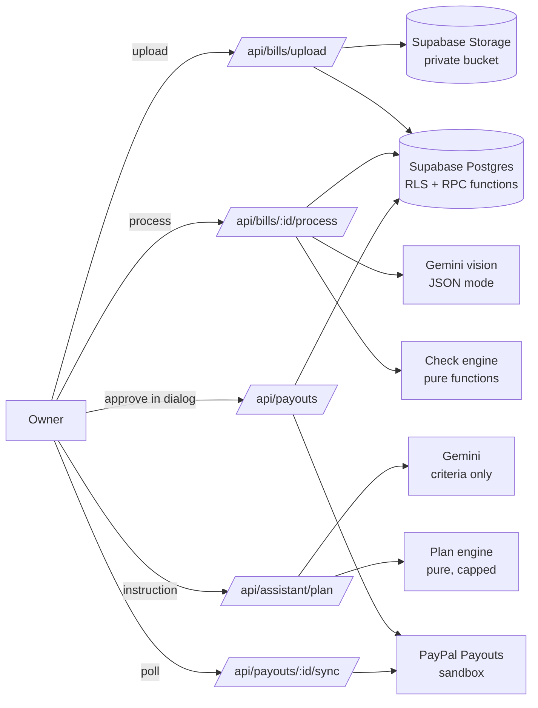

# FleetSpend AI

**An AI accounts-payable agent for small fleet businesses: it reads every bill, catches duplicates and overcharges, and pays drivers and vendors through PayPal Payouts — only after a human approves.**

- **Live demo:** https://fleetspend-ai.vercel.app (PayPal **sandbox**, no real money moves)
- **Demo video (2:32):** https://youtu.be/NouA0U1xPnU
- **License:** MIT

> Click **Try the 8 sample bills** on the live site to see the whole flow in about a minute. Use **Reset demo** in the header to start over.

---

## The problem

A transport business with 5–50 trucks pays dozens of small bills every week: fuel stations, mechanics, parts shops, relief drivers. Bills arrive as phone photos and PDFs. The owner types them in by hand, and nobody notices when the same invoice is paid twice, a mechanic suddenly charges three times the usual amount, or a brand-new "vendor" asks to be paid.

## What FleetSpend AI does

1. **Upload bills** (photos or PDFs). **Gemini** reads each one: vendor, amount exactly as printed, currency, date, invoice number, payee PayPal email, category, and a confidence score per field.
2. **Four checks run on every bill**, with a plain-English reason for each flag:
   - **Duplicate** — same vendor + invoice number, or same vendor + amount + date
   - **Overcharge** — more than 2× the vendor's average paid bill
   - **New payee** — this vendor has never been paid before
   - **Over limit** — above the per-bill spending limit
3. **Unsure? Ask the human.** If the AI is not confident about the amount, date, vendor or currency, the bill goes to a review screen with the original photo next to the form and the unsure fields highlighted.
4. **Approve and pay with PayPal Payouts.** The owner selects bills in an **AG Grid** approval table, reviews payees and the total, types a reason for any flagged bill, and pays everyone in one PayPal Payouts batch. Bills become **Paid** only when PayPal reports `SUCCESS` for their item.
5. **AI Payment Assistant (agentic commerce).** "Pay all clean fuel bills from this week" → the assistant builds a payment plan, explains every included and excluded bill, and hands it to the same human approval dialog.

## Safety by design

| Rule | How it is enforced |
|---|---|
| The AI never moves money | Payouts are created only by `approve_and_create_batch`, called from the human approval dialog. The assistant returns **criteria only** (vendor, category, dates, limits); deterministic code picks the bills. Bill ids returned by the AI are stripped. |
| No bill is ever paid twice | Bill state machine + a partial unique index (one live payout item per bill) + PayPal idempotency (`sender_batch_id` and `PayPal-Request-Id` = our batch id). A timed-out request is resent with the same id, never a new one. |
| Flagged bills need a reason | The database rejects approving a flagged bill without an override reason; the reason is stored on the payout item and in the audit log. |
| PayPal is the source of truth | Payment status is fetched by the server from PayPal; the browser never reports success. Item outcomes only move forward (`queued → pending → success / failed`), enforced by a trigger. |
| Money is never a float | Integer cents everywhere; the AI returns the amount as printed text and code converts it. One function (`centsToPayPalValue`) produces PayPal's decimal string. |
| Full audit trail | Every status change, correction, approval (with override reasons and assistant instruction) and payout result is written to an append-only `audit_log` in the same transaction. |
| Locked-down data | Row-level security on every table with no policies; database functions are `service_role` only; bill files live in a private bucket; all keys are server-side. |

## How PayPal is used

- **OAuth2 client credentials** with token caching (`lib/paypal/client.ts`).
- **Payouts API** — `POST /v1/payments/payouts` with one item per approved bill (`recipient_type: EMAIL`, `sender_item_id` = our item id, vendor + invoice in the note), and `GET /v1/payments/payouts/{id}` to sync item status (`SUCCESS`, `PENDING`, `UNCLAIMED`, `FAILED`, `RETURNED`, …).
- **Idempotency** via `PayPal-Request-Id`; 4xx answers mark the batch rejected with PayPal's message, while timeouts / 5xx keep it "submitting" for a safe resend.
- The UI polls status every 5 seconds (for up to 2 minutes) and shows the PayPal batch id and transaction ids.

## How AI is used

- **Gemini (`gemini-3.5-flash-lite`)** in JSON mode with a response schema, validated again with zod:
  - **Bill extraction** (vision) with per-field confidence → low confidence routes the bill to human review.
  - **Payment Assistant** turns an instruction into selection criteria, or asks a clarifying question.
- Measured on the 8 sample bills: every field read correctly, 1.5–3.5 s per bill; assistant plans in 2–5 s.

## Architecture



**Stack:** Next.js 16 (App Router, Cache Components) · React 19 · TypeScript (strict) · Tailwind CSS 4 · Supabase (Postgres, Storage) · Google Gemini (`@google/genai`) · PayPal Payouts REST API · AG Grid Community 36 · zod 4 · Vitest + fast-check · Vercel.

```
app/                 pages and API route handlers
components/          UI (upload, AG Grid table, assistant, approval dialog, payments)
lib/ai/              Gemini bill extraction + schema
lib/checks/          duplicate / overcharge / new payee / policy limit (pure)
lib/pipeline/        upload → extract → check → status, behind a store interface
lib/paypal/          OAuth, Payouts client, request builder, status mapping
lib/payments/        approve → submit → sync, behind a store interface
lib/assistant/       instruction → criteria → plan (pure plan engine)
supabase/migrations/ schema, RPC functions, RLS, seed (001–009)
tests/               unit, property-based and live tests
.kiro/               specs (requirements, design, tasks) and steering docs
```

## Run it yourself

### 1. Prerequisites
- Node.js 20+ and npm
- A free [Supabase](https://supabase.com) project
- A free [Google AI Studio](https://aistudio.google.com) API key
- A [PayPal Developer](https://developer.paypal.com) sandbox app with **Payouts** enabled. **Its sandbox business account must be in a country that can send Payouts (e.g. United States).** Accounts in some countries get `PAYOUT_NOT_AVAILABLE`.
- 1–3 sandbox **personal** accounts to receive payments.

### 2. Database
Run the SQL files in order in the Supabase **SQL Editor** (or with the Supabase CLI):

```
supabase/migrations/001_create_vendors.sql … 009_assistant_plans.sql
supabase/seed.sql
```

The seed creates 5 vendors with 15 paid bills of history so the checks have something to compare against. Migration `007` points the demo vendors at specific sandbox emails — change them to your own sandbox personal accounts.

### 3. Environment
Copy `.env.example` to `.env.local` and fill it in:

| Variable | Example | Notes |
|---|---|---|
| `SUPABASE_URL` | `https://xyz.supabase.co` | Project Settings → Data API |
| `SUPABASE_SERVICE_ROLE_KEY` | `sb_secret_…` | Server only |
| `GEMINI_API_KEY` | | Google AI Studio |
| `GEMINI_MODEL` | `gemini-3.5-flash-lite` | Benchmark others with `node scripts/bench-gemini.mjs` |
| `POLICY_LIMIT_MINOR_UNITS` | `100000` | Per-bill limit in cents ($1,000) |
| `DEMO_MODE` | `true` | Shows **Reset demo** |
| `PAYPAL_CLIENT_ID` / `PAYPAL_CLIENT_SECRET` | | Sandbox app |
| `PAYPAL_API_BASE` | `https://api-m.sandbox.paypal.com` | Non-sandbox hosts are refused |

### 4. Run
```bash
npm install
npm run dev
```
Open http://localhost:3000 and click **Try the 8 sample bills**. The fictional sample bills live in `public/samples/` (regenerate with `python scripts/generate-sample-bills.py`).

### 5. Test
```bash
npm test
```
**205 offline tests** (unit + **13 property-based properties** with fast-check) cover money conversion, vendor matching, the four checks, the processing pipeline, the PayPal client, the payment workflow and the payment-plan engine. Live tests against the real services are opt-in:

```bash
LIVE_GEMINI=1 npx vitest --run tests/live-gemini.test.ts tests/live-assistant.test.ts
LIVE_SUPABASE=1 npx vitest --run tests/live-supabase.test.ts
LIVE_PAYPAL=1 npx vitest --run tests/live-paypal.test.ts   # pays $1.00 in the sandbox
```

`docs/manual-test-checklist.md` walks through the full demo with expected results for every sample bill.

## Demo walkthrough

1. **Reset demo** → **Try the 8 sample bills**. Four become **Ready to pay**, one **Duplicate** (invoice MAR-002 was already paid), one **Overcharge** ($450 vs a $200 average), one **New payee**, and one blurry receipt goes to **Needs review**.
2. **Review** the blurry receipt: the AI marks the amount and date as unsure; correct them and the checks run again.
3. **Payment Assistant:** "Pay all Apex Fuel bills, including flagged ones" → plan with reasons → **Review & approve** → type why the overcharge is OK → **Pay with PayPal**.
4. Watch bills move to **Paid** with PayPal transaction ids; the **Payments** panel shows the batch, and the sandbox receivers' balances go up.

## Known limitations

- USD only; one demo owner (no login) in this version.
- Vercel limits request bodies to about 4.5 MB, so very large PDFs may fail on the hosted demo (10 MB works locally). Bills are uploaded one per request.
- The hosted demo is public and shares one database: anyone can reset it.
- PayPal webhooks are not used yet; status is polled.

## How it was built

Built for the **PayPal AI Hackathon** and **Kiroween 2026**, spec-first:

- **Kiro** was used to write the steering docs and the first spec (`.kiro/specs/invoice-processing`: requirements → design → tasks), reviewed and refined over several rounds.
- When the free Kiro credits ran out mid-project, implementation continued with **Claude Code**, following the Kiro spec task by task and ticking tasks in `tasks.md`. The next two specs (`payment-workflow`, `approval-agent`) were written in the same Kiro spec format before any code. Commit messages note which tool did the work.
- Every money-moving rule was tested first with property-based tests, then verified live against Supabase, Gemini and the PayPal sandbox.

## License

MIT — see [LICENSE](LICENSE). All businesses, people and bills in the sample data are fictional.
